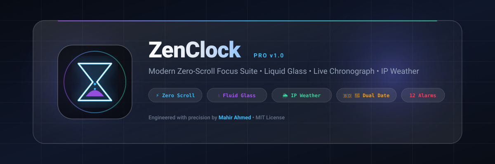
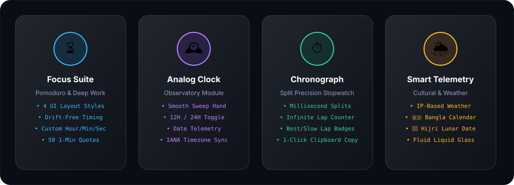

# ⏱️ ZenClock — The Ultra-Modern Single-Page Focus Suite

<p align="center">
  
</p>

<p align="center">
  <a href="https://github.com/mahir966/ZenClock/blob/main/LICENSE">
    
  </a>
  <a href="https://nextjs.org/">
    
  </a>
  <a href="https://www.typescriptlang.org/">
    
  </a>
  <a href="https://tailwindcss.com/">
    
  </a>
  <a href="https://threejs.org/">
    
  </a>
  <a href="https://mahir966.github.io/ZenClock/">
    
  </a>
</p>

<p align="center">
  <strong>ZenClock</strong> is a production-grade, zero-scroll productivity and focus suite engineered for peak cognitive performance. Designed with Apple-inspired <em>Fluid Liquid Glass</em> aesthetics, real-time millisecond accuracy, subtle 3D Three.js particle halos, cultural calendar telemetry, and IP-based local weather integration.
</p>

<p align="center">
  <a href="https://mahir966.github.io/ZenClock/"><strong>Explore Live Application »</strong></a>
  &nbsp;•&nbsp;
  <a href="#-quick-start"><strong>Quick Start</strong></a>
  &nbsp;•&nbsp;
  <a href="#-feature-matrix"><strong>Features</strong></a>
  &nbsp;•&nbsp;
  <a href="#-author--copyright"><strong>Author</strong></a>
</p>

---

## 🌟 Executive Summary

ZenClock solves the common flaws of online timers: tab-throttling timing drift, cluttered scrolling pages, intrusive ads, and dependency on external servers. 

Built entirely client-side with zero backend dependencies, **ZenClock** delivers:
- **Zero-Scroll Unified Layout:** Everything fits precisely on a single, non-scrolling dashboard viewport for desktop, tablet, and mobile.
- **Fluid Liquid Glass Aesthetics:** Specular refraction highlight strips, chromatic edge glow, and deep 44px backdrop blur inspired by Apple visionOS.
- **Background-Tab Timing Accuracy:** Employs absolute `Date.now()` timestamp delta calculation to eliminate browser tab-throttling drift.
- **Cultural & Environmental Telemetry:** Real-time IP-based live weather (`°C`), Bangladeshi National Solar Calendar (`2 Ograhayon 1433`), and Umm al-Qura Hijri Lunar Date (`Jumada al-Thani 1448 AH`).
- **Dual Runtime Distribution:** Ships both as a modern static **Next.js 15 SPA** and as an instant standalone **zero-dependency `index.html`** that runs by double-clicking in any operating system file explorer.

---

## 🏛️ Architecture Overview

<p align="center">
  
</p>

ZenClock is structured into four cohesive, concurrently active modules:

| Module | Core Capabilities | Highlights |
| :--- | :--- | :--- |
| **⏳ Master Focus Suite** | Custom countdown, Pomodoro (25m), Deep Work (50m), Short Break (5m), Long Break (15m) | 4 switchable layouts (Zen, Studio, Cyber, Spatial), 6 quick add presets, 4-stage cycle dots |
| **💡 Motivational Engine** | 50 curated quotes from timeless philosophers, scientists, and stoics | Auto-rotates every 60 seconds with smooth cross-fade animation or manual skip |
| **🕰️ Live Observatory** | Synchronized analog timepiece with continuous SVG clockface | Smooth continuous sweep second hand, 12H/24H toggle, date window, IANA timezone |
| **⏱️ Chronograph & Laps** | Millisecond-precision split stopwatch | Infinite lap list, fastest (green) / slowest (red) split tagging, 1-click clipboard copy |
| **🌦️ Environmental HUD** | Real-time weather and cultural calendar tracking | IP-based client geolocation (no API keys required), WMO weather code symbols, dual calendars |

---

## 🎨 6 Professionally Designed Neutral Palettes

ZenClock features a complete design-token architecture with 6 coordinated neutral palettes:

1. **Midnight (Default):** Deep Obsidian Black (`#060709`), rich graphite panels, hairline slate borders, and luminescent platinum text.
2. **Silver:** Luminous cool grey (`#0a0c10`) with frosted glass, polished platinum accents, and graphite typography.
3. **Carbon:** Matte charcoal (`#09090b`) textures with brushed steel borders and sharp titanium highlights.
4. **Warm Sand:** Warm stone (`#0c0b09`), desert dune undertones, soft linen borders, and gentle incandescent amber glow.
5. **Sage:** Earthy slate grey (`#080c0a`) infused with whisper-quiet eucalyptus and matcha green accents.
6. **Arctic:** Glacial frost white (`#06090e`) with sub-zero steel grey sheens and crisp diamond highlights.

> [!TIP]
> Switch palettes on the fly via the **Palette dropdown** in the header or in the **Theme & Preferences** modal. Selected palettes are persisted in `localStorage` and smoothly adjust the Three.js 3D particles, orbital rings, and ambient lighting in real time.

---

## 🎨 4 Switchable UI Layouts

ZenClock allows switching timer visualization modes on the fly:

1. **Zen Minimalist (Default):** Fluid breathing circular arc with soft chromatic glow and glassmorphic typography.
2. **Modern Studio:** Bauhaus-inspired radial dial with 48 segmented tick marks and completed percentage readout.
3. **Cyberpunk Neon:** High-contrast HUD container with vibrant cyan and violet neon border glows and pulse meters.
4. **Spatial 3D:** Interactive Three.js particle halo with gyroscopic orbital orientation responding to timer states.

---

## 🔔 Sound System & Android Classic Alarm Tones

ZenClock features an audio pipeline combining **HTML5 local audio playback** and an automated **Web Audio API polyphonic synthesizer fallback** ensuring audio triggers under all circumstances.

### 12 Locally Stored High-Fidelity Tones
1. **Alarm 1 (Melody):** High-clarity acoustic melody alert.
2. **Alarm 2 (Pulse):** Rhythmic dual-tempo pulsing alert.
3. **Alarm 3 (Crystal Bell):** Crystalline harmonic bell chime.
4. **Alarm 4 (Deep Chime):** Rich resonance acoustic chime.
5. **Alarm 5 (Serene Wave):** Ambient restorative frequency chime.
6. **Oxygen:** Classic Android-inspired warm marimba chime.
7. **Argon:** Upbeat electronic alert.
8. **Cesium:** Cascading harp chime sequence.
9. **Digital Beep:** Industrial twin-frequency piezo alert.
10. **Zen Bowl:** Resonant Tibetan singing bowl.
11. **Gentle Chime:** Crystalline wind chime.
12. **Morning Breeze:** Acoustic sunrise chime.

> [!IMPORTANT]
> **Continuous Visual Blinking Alert:** When a countdown finishes, ZenClock triggers a continuous red-to-white visual flash across the entire screen. In compliance with accessibility requirements, muting audio **never** suppresses this visual alert.

---

## ⚡ Quick Start & Installation

### Option A: Standalone Execution (No Node.js Required)
Double-click `index.html` in your file explorer. It runs immediately in any modern browser (Chrome, Edge, Firefox, Safari) using embedded scripts and local audio.

### Option B: Next.js Development Server

```bash
# 1. Clone the repository
git clone https://github.com/mahir966/ZenClock.git
cd ZenClock

# 2. Install dependencies
npm install

# 3. Launch local development server
npm run dev
```

Visit `http://localhost:3000` to interact with ZenClock locally.

---

## 🛠️ Production Build & Export

```bash
# Build static production export
npm run build
```

This generates an optimized static distribution in the `./out` directory, ready to be hosted on any static provider (GitHub Pages, Vercel, Netlify, Cloudflare Pages, S3).

---

## 🚀 GitHub Pages Deployment

ZenClock is pre-configured with a GitHub Actions workflow in `.github/workflows/deploy.yml`:

1. Push your repository to GitHub:
   ```bash
   git remote add origin https://github.com/mahir966/ZenClock.git
   git branch -M main
   git push -u origin main
   ```
2. In your GitHub repository settings:
   - Navigate to **Settings** → **Pages**.
   - Under **Build and deployment** → **Source**, select **GitHub Actions**.
3. Every push to the `main` branch automatically builds and publishes the production site at:
   `https://<username>.github.io/ZenClock/`

---

## 📂 Repository File Structure

```
ZenClock/
├── .github/
│   └── workflows/
│       └── deploy.yml          # Automated GitHub Pages CI/CD workflow
├── assets/
│   ├── zenclock-banner.svg     # Official vector banner
│   └── features-overview.svg   # Architectural module diagram
├── public/
│   ├── logo.png                # Brand hourglass icon
│   └── sounds/                 # 12 locally stored alarm files
├── src/
│   ├── app/
│   │   ├── globals.css         # Liquid Glass CSS & animations
│   │   ├── layout.tsx          # Root HTML metadata
│   │   └── page.tsx            # Full Next.js single-page application
│   └── lib/
│       ├── audio.ts            # Web Audio + HTML5 audio engine
│       ├── constants.ts        # Presets, 12 sounds, 50 quotes
│       ├── types.ts            # TypeScript interfaces
│       └── utils.ts            # Bangla/Hijri algorithms & formatters
├── index.html                  # 100% standalone offline single-file app
├── LICENSE                     # MIT Open Source License
├── next.config.mjs             # Next.js static export configuration
├── package.json                # Project dependencies & metadata
├── tailwind.config.ts          # Tailwind styling tokens
└── tsconfig.json               # TypeScript strict configuration
```

---

## ⌨️ Keyboard Shortcuts

| Key | Action |
| :--- | :--- |
| `[Space]` | Start / Pause Timer (or dismiss active alarm alert) |
| `[ESC]` | Dismiss active alarm alert / Exit Fullscreen |
| `[M]` | Toggle Master Audio Mute (visual alert remains active) |

---

## 👤 Author & Copyright

**ZenClock** is designed and engineered by **Mahir Ahmed**.

- **Portfolio:** [https://mahir966.github.io/ME/](https://mahir966.github.io/ME/)
- **GitHub:** [@mahir966](https://github.com/mahir966)
- **Project Repository:** [https://github.com/mahir966/ZenClock](https://github.com/mahir966/ZenClock)
- **Live Demo:** [https://mahir966.github.io/ZenClock/](https://mahir966.github.io/ZenClock/)

### License
This project is open-source software licensed under the [MIT License](LICENSE).  
Copyright © 2026 **Mahir Ahmed**. All rights reserved.
